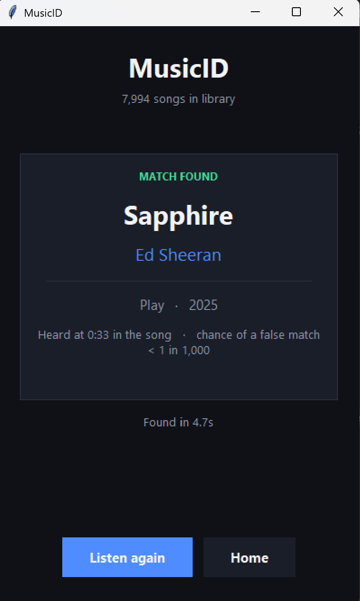
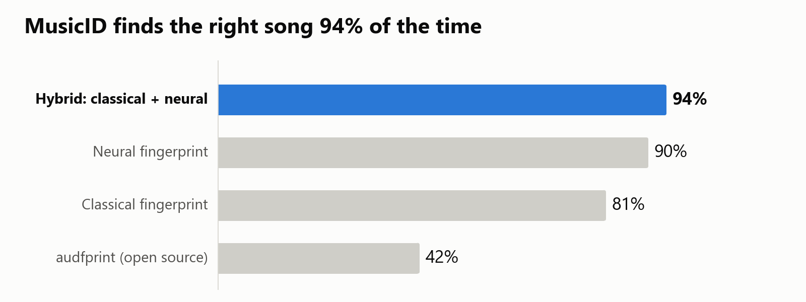

# MusicID

Recognises a song from a few seconds of audio heard through the microphone, like Shazam.

  

| Method | Finds the right song | Wrong matches |
|---|---|---|
| **Hybrid: classical + neural** | **93.9 %** | 1.4 % |
| Neural fingerprint | 90.1 % | 1.6 % |
| Classical fingerprint | 81.2 % | 1.2 % |
| audfprint (open source) | 42.2 % | 0.5 % |

Tested on 17,600 clips (1–10 s, with noise, echo and phone-mic recordings) against a library of 4,000 songs.

## How it works

1. **Fingerprint:** the loudest points of the spectrogram are paired into hashes (Wang, 2003).
2. **Neural fingerprint:** a small CNN trained with contrastive learning turns each second of audio into a vector.
3. **Decision:** statistics (quasi-Poisson p-values, conformal thresholds) keep wrong matches near 1 %.
4. **Hybrid:** a learned model combines both fingerprints and picks the answer.

## Documents

- [Project overview with all the maths (2 pages)](docs/MusicID_Project_Overview.pdf)
- [Technical report (6 pages)](docs/MusicID_Technical_Report.pdf)

## Running it

See [HOW_TO_RUN.txt](HOW_TO_RUN.txt).

## Credits

Wang (2003), *An industrial-strength audio search algorithm* · Chang et al. (2021), *Neural audio fingerprint* ·
FMA dataset (Defferrard et al., 2017) · audfprint (D. Ellis).
